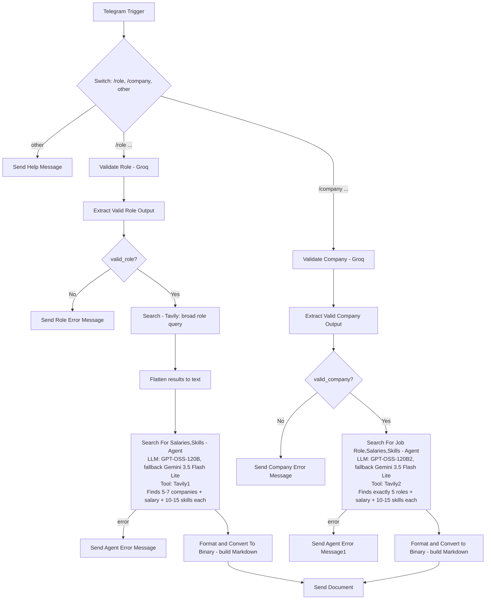

# Job Market Research Bot

A Telegram bot with two commands — `/role <job role>` and `/company <company name>` — that researches the current Indian job market and returns a detailed salary + skills report as a downloadable Markdown file. `/role` finds 5–7 companies hiring for that role; `/company` finds 5 roles that company hires for. Both include per-entry salary ranges and 10–15 depth-researched skills, plus a common-skills summary across all entries.

## What it does

**`/role <job role>`**
1. An LLM validates that the input is a real, recognizable job role.
2. If invalid, the bot asks for a valid role with an example.
3. If valid, one broad Tavily search runs first (companies hiring for that role in India, 2026, salary + skills) and its results are flattened into plain text.
4. A research agent takes that as a starting point and, using its own Tavily tool, identifies at least 5 distinct companies (up to 7), then researches per-company salary data and 10–15 specific skills for each — searching again with sharper queries whenever the initial content doesn't surface enough companies or enough skill depth.
5. The structured result (schema-enforced) is rendered into a Markdown report — one section per company, with salary and skills — plus a common-skills summary, and sent as a Telegram document.

**`/company <company name>`**
1. An LLM validates that the input is a real, recognizable company.
2. If invalid, the bot asks for a valid company with an example.
3. A research agent identifies exactly 5 distinct roles that company hires for in India, researching per-role salary and 10–15 skills each via its own Tavily tool.
4. The structured result is rendered into a Markdown report — one section per role — plus a common-skills summary, and sent as a Telegram document.

Any message that isn't `/role ...` or `/company ...` gets a help message listing both commands.

## Flow diagram

## Tech stack

| Component | Role |
|---|---|
| n8n | Orchestration |
| Telegram Bot API | Trigger + command routing + document delivery |
| Groq (`openai/gpt-oss-20b`, `openai/gpt-oss-120b`) | Role/company validation, both research agents, structured-output parsing |
| Google Gemini (`gemini-3.5-flash-lite`) | Fallback LLM for both research agents |
| Tavily Search API | One direct search node (role path only) + one in-agent tool per path |
| n8n LangChain Agent + Structured Output Parser (×2) | Schema-enforced JSON for both report types |

## Prerequisites

- n8n with LangChain and Tavily community nodes installed.
- A Telegram bot token.
- A Groq API key.
- A Google AI Studio (Gemini) API key.
- A Tavily API key.

## Setup

1. Import the workflow JSON into n8n (no `name` field is set in this export — name it on import, e.g. "Job Market Research Bot").
2. Attach credentials (arrive unlinked — secrets are never exported):
   - `telegramApi` → **Trigger**, **Send Role Error Message**, **Send Company Error Message**, **Send Help Message**, **Send Agent Error Message**, **Send Agent Error Message1**, **Send a document**
   - `groqApi` → **Validate Role**, **Validate Company**, **GPT-OSS-120B1**, **GPT-OSS-120B2**, **GPT-OSS-20B**, **GPT-OSS-20B1**
   - `googlePalmApi` → **FLASH-3.5-LITE**, **FLASH-3.5-LITE1**
   - `tavilyApi` → **Search**, **Tavily1**, **Tavily2**
3. Verify the Gemini model string (`models/gemini-3.5-flash-lite`) is still valid for your account.
4. Activate and test both `/role <role>` and `/company <company>`.

## Notes & Limitations

- Salary figures are based on available web research and may vary by location, experience, role, and company.
- Reported salaries are presented when a source provides a direct figure; estimates are used when sufficient data is available but an exact figure is not found.
- Salary ranges should be treated as indicative rather than guaranteed compensation.
- Job requirements can change over time, so the report may not reflect every current opening.
- Company and role results are limited to the number defined by the workflow: 5–7 companies for `/role` and exactly 5 roles for `/company`.
- The bot does not scrape or access private hiring data; results depend on publicly available sources indexed by the search tool.

